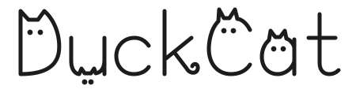

  

  <i>你好，这里是 DuckCat &nbsp;^  ^</i>

 

### 🐾 关于我

- 🤖 平时喜欢捣鼓 AI 相关的东西
- 🧪 看到好玩的新工具就想上手试试
- 🛠️ 偶尔折腾点小玩意儿，慢慢放上来
- 📫 有事找我：[mr.duckcatttttt@gmail.com](mailto:mr.duckcatttttt@gmail.com)

### 🧶 常用工具

  
  
  
  

### 🧩 技术栈

  <picture>
    <source media="(prefers-color-scheme: dark)" srcset="https://skillicons.dev/icons?i=ts%2Cpy%2Cjs%2Cnodejs%2Cpytorch%2Cdocker%2Clinux%2Cgit&theme=dark" />
    
  </picture>

### 🌷 碎碎念

> 能跑就行 (ฅ´ω`ฅ)

 

  

